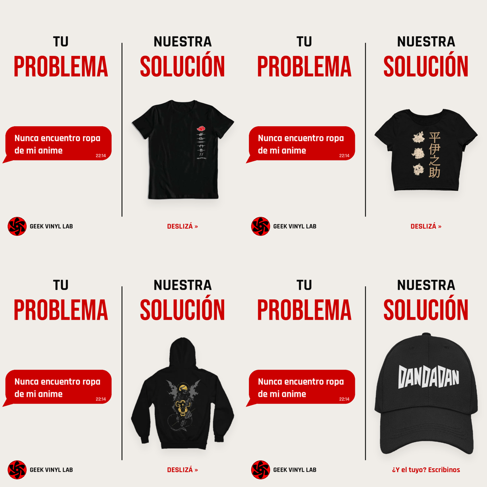

# Guía de uso: Socio Creativo

Última actualización: 2026-10-17

Esta guía es para quien usa el Socio Creativo en su negocio, sin necesidad de saber nada técnico. Si es tu primera vez, empezá por "Antes de empezar".

## Qué es y para qué sirve

El Socio Creativo es tu asistente de marketing dentro de Claude: te ayuda a decidir qué publicar, escribirlo, diseñarlo, revisarlo y editarlo, siempre con la identidad de tu negocio.

No necesitás saber de diseño ni de marketing. Le hablás como a un compañero de equipo y él se encarga del método. Hace cuatro cosas:

| Módulo | Qué le pedís | Qué recibís |
| --- | --- | --- |
| Estrategia y copy | Ideas de posts, guiones, calendarios, ganchos, captions | Texto listo para usar, con plataforma, formato y llamado a la acción |
| Diseño visual | Un carrusel o imagen, con el texto ya escrito | Imágenes PNG de 1080x1080 con tus colores, tipografías y logo |
| Auditoría | Que revise un post antes de publicarlo | Una revisión en 5 bloques con qué corregir |
| Edición de video | Que corte, una y subtitule tus clips | Un video terminado, listo para subir |

Conoce tu negocio porque lee los documentos de tu Project (tu cliente ideal, tu catálogo, tu tono, tus colores). Y trabaja siempre con la metodología más reciente: se mejora desde un solo lugar y vos no tenés que actualizar ni subir nada.

## Antes de empezar: lo que tiene que estar listo

El Socio Creativo no inventa tu negocio, lo lee de los documentos de tu Project. Con estos seis documentos y tu logo, trabaja al 100 %.

| Documento | Qué lleva | Para qué lo usa |
| --- | --- | --- |
| `buyer-persona.md` | Tu cliente ideal: edad, motivaciones, dolores, en qué redes está | Escribir mensajes que le hablen a él |
| `catalogo.md` | Tus productos y servicios, productos estrella, disponibilidad | Saber qué mostrar y qué prometer |
| `objetivos.md` | Qué querés lograr con tu contenido y qué métricas te importan | Elegir el tipo de pieza correcto |
| `identidad-marca.md` | Colores en hex, tipografías, tono de voz, frases de marca, qué te diferencia | Que todo suene y se vea como tu marca |
| `estado-redes.md` | Qué te ha funcionado y qué no en tus redes | No repetir errores y apoyarse en lo que ya funciona |
| `restricciones.md` | Qué no se muestra ni se dice, quién sale en cámara, límites con marcas de terceros, información interna que no se cuenta | Respetar tus límites siempre |
| Logo (PNG con fondo transparente) | Tu isotipo o logo | Ponerlo en carruseles e imágenes |

También conviene tener a mano fotos reales de tu producto. El Socio Creativo nunca inventa fotos: te las pide.

Si falta algún documento, no pasa nada: te pide el dato puntual en vez de adivinarlo. Para comprobar qué hay cargado, escribile:

```text
Revisá la configuración de mi Project y decime qué documentos faltan para trabajar bien.
```

## Cómo pedirle cosas

Un buen pedido dice qué querés, para qué plataforma y con qué material. Lo demás lo resuelve él. Normalmente se activa solo al pedir contenido de marketing; para asegurarte, empezá el mensaje con `/socio-creativo-generico`.

| Si querés... | Escribile algo así |
| --- | --- |
| Ideas para la semana | Dame 5 ideas de contenido para esta semana en Instagram y TikTok. Tengo 20 minutos para filmar. |
| Un guion de video | Armame un guion de 25 segundos para mostrar [producto]. Quiero que nos descubra gente nueva. |
| Un calendario | Armame un calendario de contenido de 2 semanas para lanzar [producto nuevo]. |
| Ganchos | Dame 5 ganchos para un reel sobre [tema]. |
| Un caption | Escribime el caption de esta foto para Instagram, con hashtags. |
| Un carrusel | Diseñame un carrusel con este guion: [pegás el texto]. Te adjunto las fotos del producto. |
| Revisar un post | Revisá este post antes de publicarlo. [adjuntás la imagen y el caption] |
| Editar un video | Uní estos clips en este orden, con subtítulos, en formato vertical. [adjuntás clips y guion] |
| No saber por dónde empezar | Quiero vender más [producto] y no sé qué publicar. ¿Qué me recomendás? |

Cuatro hábitos que mejoran todo:

- Adjuntá fotos reales de tu producto cuando pidas diseño.
- Decí la plataforma (Instagram, TikTok, Facebook) y cuánto tiempo tenés para producir.
- Pedí varias versiones: tres ideas distintas se comparan mejor que una sola.
- Corregí con confianza. "Más corto", "menos formal" o "con otro enfoque" funcionan perfecto.

## Estrategia y copy

Para cada pieza, el Socio Creativo elige una estructura de contenido probada. No tenés que elegirla vos, pero conviene conocerlas para saber qué pedir.

| Patrón | Qué hace | Usalo cuando | Formatos |
| --- | --- | --- | --- |
| Doble Caída | Gancho sensorial, puente de empatía, clímax y cierre conversacional | Querés mostrar un producto o un proceso en video corto | Reel o TikTok de 30 a 40 s |
| Rompe-creencia | Niega una idea que todo el nicho da por cierta y la reemplaza por el deseo real | Querés detener el scroll | Reel, carrusel, foto, historia |
| Historia que vende | Una sola historia con un hook en segunda persona que invita a imaginarse usando el producto | Querés vender sin sonar a venta | Stories |
| Pilares de valor | Preguntas abiertas y pequeñas recompensas repartidas en la pieza | La gente ve el inicio y se va | Reel, carrusel, historias |
| Problema–solución en espejo | Una queja fija de tu cliente y una solución distinta en cada deslizada | Querés mostrar variedad de producto sin vender | Carrusel de 3 a 6 slides, reel corto |

Todo se ordena según el embudo de ventas, que tiene cuatro etapas:

1. **Descubrimiento:** que alguien que no te conoce se identifique con lo que ve.
2. **Consideración:** que empiece a imaginarse usando o comprando lo tuyo.
3. **Decisión:** que dé el paso, normalmente por mensaje directo o WhatsApp.
4. **Comunidad:** que vuelva y te recomiende.

También podés pedir un embudo de contenido completo para un producto específico o para todo tu negocio: te hace unas preguntas de entrada y te lo entrega con el peso que corresponde a cada etapa según tu objetivo.

Un buen calendario semanal mezcla cuatro ejes: un producto con alma (dos veces), un tema de comunidad, un vistazo al proceso y una prueba social. Por eso, cuando le pedís un calendario, no repite la misma estructura en todas las piezas.

Por defecto, el contenido para atraer gente nueva no lleva precio, oferta ni "compra ahora". Si tu negocio necesita un tono más directo, decíselo y lo ajusta.

Ejemplo de pedido:

```text
Armame 3 ideas de reel para atraer gente nueva a [mi producto estrella], cada una con una estructura distinta. Tengo 15 minutos para filmar y solo salimos mi socio y yo en cámara.
```

## Diseño de carruseles e imágenes

Le das el texto y las fotos de tu producto, y te devuelve imágenes PNG de 1080x1080, listas para subir, con los colores, tipografías y logo de tu marca.

Cómo se trabaja, en cuatro pasos:

1. Tené el guion del carrusel. Si todavía no lo tenés, pedile primero que lo escriba.
2. Adjuntá fotos reales de tu producto. Nunca las inventa.
3. Pedilo: "Diseñame este carrusel" y pegás el texto.
4. Revisalo y pedí ajustes: "agrandá el título de la slide 2", "cambiá el orden".

La primera vez que lo usás para tu negocio, configura tu tema visual a partir de tu `identidad-marca.md`: colores, tipografías y logo. Es un paso único; después lo recuerda.

Cada slide sigue uno de seis diseños, que él elige según lo que cuenta:

- **Portada:** solo texto, con el titular centrado. Es la que detiene el scroll.
- **Foto con titular debajo:** para fotos de contexto o de proceso.
- **Solo texto:** una frase emocional para que el copy respire.
- **Producto a sangre completa:** la foto del resultado terminado con texto encima.
- **Cierre con llamado a la acción:** frase de marca y una invitación suave.
- **Dividido en dos columnas (Tu problema / Nuestra solución):** una queja fija a la izquierda y un producto distinto en cada slide a la derecha.

Tres cosas que siempre cuida: que el texto se lea bien en un celular, que no use emojis dentro de la imagen (usa flechas de texto como »), y que cada imagen quede revisada antes de entregártela.

## Auditoría: revisar un post antes de publicar

Compartís tu imagen, caption, reel o carrusel y te dice si está listo para salir y qué corregir, ordenado por importancia.

Siempre revisa cinco bloques, aunque pidas solo el copy:

| Bloque | Qué mira |
| --- | --- |
| 1. Diagnóstico rápido | Si tu cliente se identifica en los primeros 2 segundos, qué detiene la mirada y si el llamado a la acción es obvio |
| 2. Copy | Primera línea, cuerpo, llamado a la acción y hashtags |
| 3. Visual | Jerarquía, que el texto se lea bien en un celular, que coincida con tu marca y que no haya nada cortado |
| 4. Estrategia | Si corresponde a la etapa del embudo y si aporta algo más que hablar de tu negocio |
| 5. Correcciones | Una lista concreta, con versiones mejoradas del copy si hacen falta |

Las correcciones llegan con tres niveles de urgencia: crítico (no publicar sin corregir), importante (mejora significativa) y sugerencia (opcional). Y cierra con un veredicto: listo para publicar, con ajustes menores, requiere revisión o no publicar.

Para usarlo, adjuntá la imagen o pegá el texto y escribí:

```text
Revisá este post antes de que lo publique en Instagram. Es para atraer gente nueva.
```

## Edición de video

Le subís tus clips sueltos y el guion, y te devuelve un video terminado, en el orden del guion, con subtítulos si los querés.

Lo que tenés que darle:

1. Los clips sueltos.
2. El guion: qué pasa en cada escena, cuánto dura y qué se dice.
3. Qué clip va en cada escena. Si no está claro, te pregunta antes de adivinar.
4. Si querés subtítulos, y si van dentro del video o como archivo aparte.
5. El formato. Si no decís nada, sale vertical 9:16, el de Reels y TikTok.

Lo que recibís: el video final listo para subir, el archivo de subtítulos si lo pediste, y una comprobación de duración, resolución y audio antes de entregarlo. Después podés pedir ajustes.

Si falta un clip, o una escena dura más que el clip que tiene, te avisa en lugar de inventar una solución.

```text
Uní estos 5 clips en el orden del guion, con subtítulos dentro del video, en formato vertical para TikTok.
```

## Ejemplo real: un carrusel paso a paso

Así nació un carrusel de 4 slides para una tienda de ropa geek, de la idea al diseño final, en una sola conversación.



**1. Lo que se le pidió.** El negocio compartió capturas de un post que le gustó, de otra tienda, y escribió: "mirá la creatividad de este post, ¿vale la pena replicar este estilo?". Después adjuntó fotos de cuatro prendas y pidió: "vamos a replicarlo con estas prendas".

**2. Lo que hizo el Socio Creativo.**

1. Reconoció la estructura del post: una queja fija del cliente y una solución distinta en cada slide.
2. Eligió una queja que su cliente ideal diría de verdad: "Nunca encuentro ropa de mi anime".
3. Ordenó las cuatro prendas de la más común a la más inesperada, cerrando con una gorra.
4. Recortó el fondo de cada foto y las diseñó con los colores, las tipografías y el logo de la marca.
5. Comprobó que la columna izquierda fuera idéntica en las cuatro slides antes de entregar.

**3. Lo que recibió.** Cuatro imágenes PNG de 1080x1080, más un caption con hashtags listo para pegar:

```text
Tu anime favorito también merece un lugar a medida. Contanos cuál es el tuyo y lo diseñamos juntos, con mockup antes de producir.

#geekvinyllab #anime #ropageek #costarica #personalizado
```

**Por qué funciona.** La queja está dicha en la voz del cliente, así que se lee como un mensaje real y no como un anuncio. Muestra el catálogo sin nombrar precios. Y no hubo que filmar nada, solo usar fotos de producto que el negocio ya tenía.

## Reglas que siempre respeta y lo que no hace

Estas reglas protegen tu marca. Si algo parece que las rompe, probablemente falta un dato en tu Project.

**Siempre:**

- Usa los colores, el tono y las frases de tu `identidad-marca.md`, no una marca genérica.
- Respeta tu `restricciones.md`: lo que no se muestra, lo que no se cuenta y quién puede salir en cámara.
- Te pide el dato que falta en vez de inventarlo.
- Muestra solo lo real: productos, trabajos y resultados que tu negocio puede entregar.
- Revisa cada imagen antes de dártela.
- Te avisa si no pudo traer la metodología más reciente, en lugar de trabajar con una versión vieja sin decírtelo.

**Nunca:**

- Inventa fotos de producto, testimonios ni resultados.
- Pone precio, oferta ni "compra ahora" en contenido para atraer gente nueva, salvo que lo pidas.
- Sugiere que tenés licencia oficial de una marca, personaje o franquicia que no es tuya.
- Mezcla la identidad visual de dos negocios en un mismo archivo.
- Publica por vos: te entrega los archivos y el texto, y vos decidís cuándo subirlos.

## Preguntas frecuentes

| Si pasa esto | Probá esto |
| --- | --- |
| Responde algo genérico o no parece conocer mi negocio | Empezá el mensaje con `/socio-creativo-generico` y pedile que revise qué documentos faltan en tu Project |
| Me pregunta datos que ya le di | Esos datos no están en un documento del Project. Subí o actualizá el documento correspondiente |
| Los colores de las imágenes no son los de mi marca | Revisá que los hex de tu `identidad-marca.md` estén bien escritos y pedile que rehaga el tema visual |
| El logo no aparece | Subí tu logo en PNG con fondo transparente al Project |
| Quiero otro estilo (fondo claro, menos texto) | Decíselo con esas palabras. Puede cambiar el estilo sin tocar el contenido |
| No sé qué publicar | Escribile: "Quiero vender más [producto] y no sé qué publicar. ¿Qué me recomendás?" |
| Una pieza me funcionó muy bien | Contale las cifras (vistas, alcance, guardados). Puede registrarla como patrón propio de tu negocio y usarla como punto de partida |
| Me avisa que no pudo traer la metodología | Es una falla temporal de conexión. Reintentá en unos minutos, o dejá que siga con su criterio general sabiendo que no es la versión más reciente |
| Tengo más de un negocio | Cada negocio necesita su propio Project con sus propios documentos. Trabajá siempre desde el Project del negocio correcto |
| ¿Me publica los posts? | No. Te entrega imágenes, textos y videos listos; vos los subís |

## Qué hay de nuevo

Cada vez que el Socio Creativo aprende un patrón nuevo o suma una función, se agrega una línea acá. Lo más reciente va primero.

| Fecha | Novedad | Qué cambia para vos |
| --- | --- | --- |
| 2026-10-17 | Patrón Problema–solución en espejo | Podés pedir un carrusel con una queja fija de tu cliente y una solución distinta en cada slide |
| 2026-10-17 | Diseño de slide en dos columnas (Tu problema / Nuestra solución) | Ese carrusel sale diseñado con tus colores, tipografías y logo |
| 2026-10-17 | Primera versión de esta guía | Ejemplos de pedidos, módulos y preguntas frecuentes en un solo lugar |
| Antes del 2026-10-17 | Base del sistema | Los cuatro módulos, los patrones Doble Caída, Rompe-creencia, Historia que vende y Pilares de valor, y el embudo de contenido a pedido |
